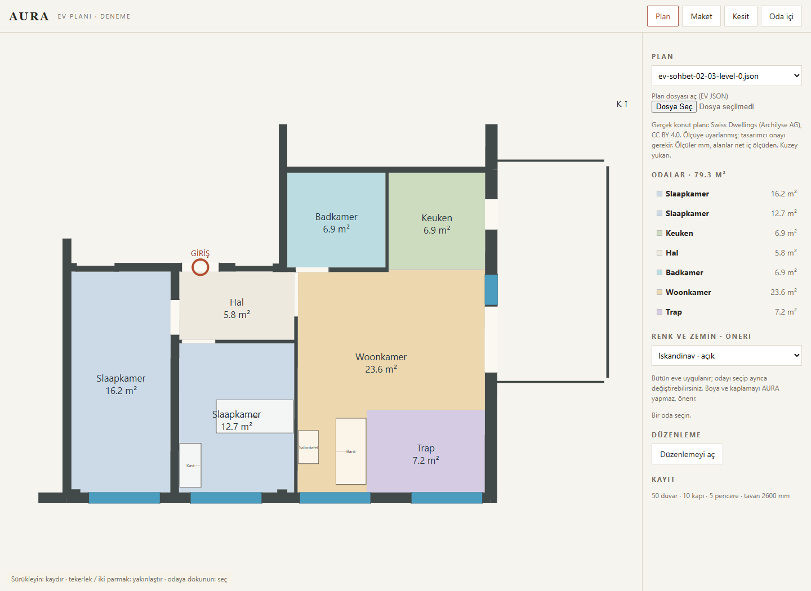
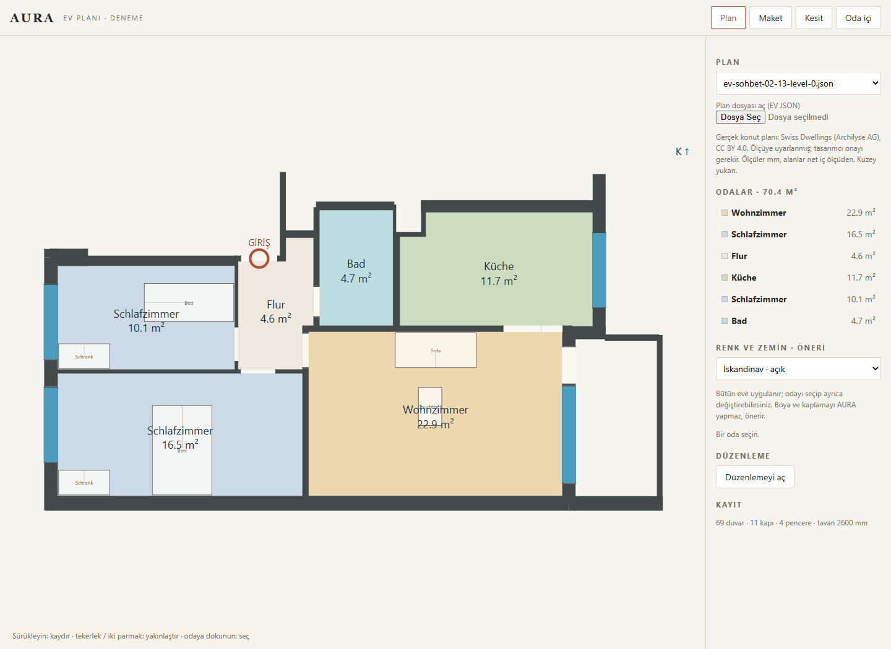
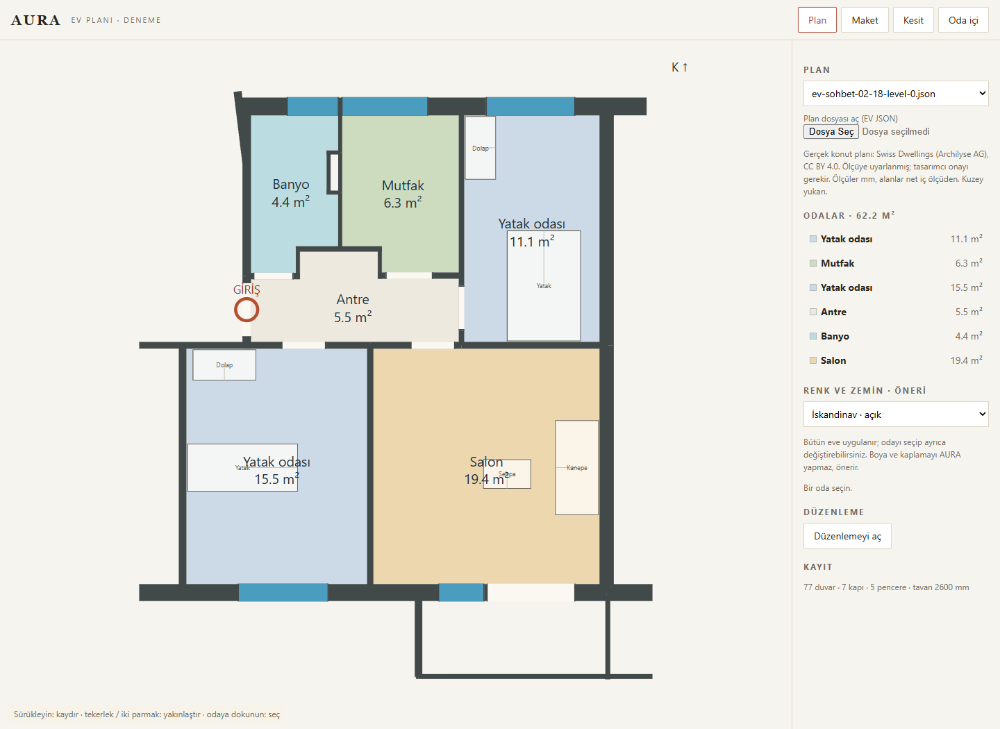

# EV-SOHBET-02 — Gerçek plan tabanlı düzeltme raporu

21 Ekim 2026 · Başlangıç `main` / `28e954a` · Dal `codex/ev-sohbet-02`.

[Sohbetleri ve bütün planları incele](EV-SOHBET-02-inceleme.html). [Makine denetimi](veri/ev-sohbet-02/denetim-sonucu.json). [Çözücü tekrar sonucu](veri/ev-sohbet-02/solver-tekrar-sonucu.json).

## Teslim ve kabulün anlamı

20 ayrı gerçek referans, 20 ayrı kurgusal kullanıcı, dört dilde sekizer alışveriş: **320 mesaj**. Dağılım BE 8 (Brüksel/Gent/Anvers/Liège ikişer), NL 4, DE 3, FR 2, TR 3. Eski 01 sohbetleri/planları kullanılmadı. Ortak cümle üretici yok; `dialogues02.py` metinleri tek tek içerir, yalnız ölçülmüş alan ve sonuç sayıları yerlerine konur. Duvar rengi/zemin mevcut durum olarak sorulur; AURA işi gibi satılmaz.

**20/20 kayıt yeni geometri hatası olmadan denetlendi; istisnasız ölçü hedefi geçişi 0/20.** Kaynak dışı oda çakışması, geçersiz/açık oda poligonu, düğümlenmemiş duvar kesişmesi, kaynak duvar/açıklık kaybı ve yerleşmiş ürün çakışması bulunmadı. Gerçek planlarda kalan **65 hedef sapması** ayrı tutuldu: 59 kapı eni, 6 pencere/taban oranı. Bu kaynak istisnaları `passed:false` olarak durur; sayılar “bütün ölçüler uygun” anlamına çevrilmedi. İş emrinin gerçek planı silmeme hükmü uygulandı.

Kapı sapması yalnız iç kapı/giriş için; geniş balkon kapısı iç kapı üst sınırına sokulmadı. Kaynak açıklığı bir kapı kanadının net geçişi olarak belgelendirilmiş değildir. Bilinmeyen kanat/çerçeve/menteşe ayrıntısı ayrıca ölçülmelidir. Kaynakla birebir eşleşmeyen yeni ölçü, istisna sayılmaz ve denetimi düşürür.

| No | Senaryo / dil | Gerçek kaynak birimi | Net iç m² | Kat | Ürün | Yeni hata | Kaynak hedef sapması |
|---|---|---|---:|---:|---:|---:|---:|
| 01 | Bruxelles / fr | `sd-0013645ec5acd14206b83a42` | 52.270 | 1 | 4 | 0 | 2 |
| 02 | Gent / nl | `sd-0032b1d21240e93d716e494f` | 80.424 | 1 | 6 | 0 | 4 |
| 03 | Antwerpen / nl | `sd-00759c3d3495e673b0acf285` | 153.103 | 2 | 7 | 0 | 4 |
| 04 | Liège / fr | `sd-007d429629bdcf55ee29f7a6` | 57.512 | 1 | 6 | 0 | 2 |
| 05 | Brussel / nl | `sd-00b7bf4a7c6719207780f9c0` | 49.041 | 1 | 4 | 0 | 2 |
| 06 | Gent / nl | `sd-00d5a4d68cf23debb37539da` | 61.088 | 1 | 4 | 0 | 2 |
| 07 | Antwerpen / nl | `sd-02ae25bc70c5ae0042b85942` | 100.650 | 2 | 7 | 0 | 2 |
| 08 | Liège / fr | `sd-00f2ab305575d56d66525c40` | 59.819 | 1 | 5 | 0 | 4 |
| 09 | Utrecht / nl | `sd-01012e138f103d05637be592` | 60.603 | 1 | 6 | 0 | 1 |
| 10 | Rotterdam / nl | `sd-01632b0f194a98bce4b20859` | 105.885 | 1 | 8 | 0 | 7 |
| 11 | Leiden / nl | `sd-017fd3e8a6fe6bfded9db447` | 107.237 | 2 | 7 | 0 | 6 |
| 12 | Eindhoven / nl | `sd-01868faaa1fb3dc9cba82beb` | 60.222 | 1 | 5 | 0 | 3 |
| 13 | Köln / de | `sd-018a420ab07f11540d713d0b` | 70.447 | 1 | 6 | 0 | 3 |
| 14 | Bonn / de | `sd-01b8e84dd18c8bfbab353c51` | 55.714 | 1 | 6 | 0 | 2 |
| 15 | Düsseldorf / de | `sd-01daabba7a440b3ad1994555` | 61.691 | 1 | 8 | 0 | 6 |
| 16 | Lille / fr | `sd-01f4dcf53cf99ff75abd5081` | 46.020 | 1 | 5 | 0 | 2 |
| 17 | Lyon / fr | `sd-022156046d08cc0646fe83e7` | 70.433 | 1 | 6 | 0 | 1 |
| 18 | İstanbul / tr | `sd-023a6880ea49d2ebbb8cb77f` | 62.193 | 1 | 6 | 0 | 2 |
| 19 | Ankara / tr | `sd-026c693f92b2cc2eb38a80cc` | 64.201 | 1 | 7 | 0 | 6 |
| 20 | İzmir / tr | `sd-00e8ebd51a43ed41a326e1cb` | 66.440 | 1 | 6 | 0 | 4 |

Net alan; iç oda poligonları, alt merdiven bölgesi ve üst sahanlık toplamıdır. Balkon/teras ve üst merdiven boşluğu dahil değildir. Kurgusal kullanıcının ilk yanlış tahmini ile son kabul ettiği net alan ayrı konuşulur; son alan geometri toplamına ±%8 içinde, pratikte onda bir m² yuvarlama farkındadır. Banyo, WC, hol ve yatak odaları oda bazında hesaplanır. Yeni planda bir 120 m² “stüdyo” veya metrekare doldurmak için şişirilmiş antre yoktur.

## Gerçek kaynak ve yapılan değişiklikler

Kaynak [Swiss Dwellings v3.0.0](https://zenodo.org/records/7788422), [CC BY 4.0](https://creativecommons.org/licenses/by/4.0/). Atıf: Standfest et al., Swiss Dwellings, 2023, DOI `10.5281/zenodo.7788422`; AURA türetmesi: gizlilik azaltımı, mm dönüşümü, semantik eşleme, eksen uyumluluk izdüşümü, rijit dönüş, eksen düğümleme, konuşmada belirtilen kullanım/kat önerileri ve mobilya denemeleri.

Önceki doğrulanmış indirme manifestindeki yayıncı MD5: `3b7915ecd5bf8e492a3e78c598b74123`; arşiv SHA256: `382e528fae3220b7747f4e6bc7d79261fee1b5d4d7902f18c548c0e6f22ef80a`. Bu tur arşivi yeniden indirmedi veya eğitimde kullanmadı. Depoda yalnız seçilmiş 20 birimin lisanslı geometri fikstürü var; her kayıtta kanonik JSON içerik hash'i (`sort_keys=True`, `ensure_ascii=False` ile SHA-256), veri kümesi/sürüm/kimlik/lisans/atıf bulunur. Bu hash boşluk/satır sonundan bağımsızdır; ham dosya byte hash'i diye okunmamalı. Adres veya müşteri fotoğrafı eklenmedi.

Bütün coğrafi senaryolar kurgusaldır: İsviçre geometrisi, Brüksel'de veya İstanbul'da ölçülmüş gerçek müşteri evi diye sunulmaz. Kaynaktaki `ROOM`, müşteri o kullanımını belirtmeden yatak odası sayılmaz. Bu konuşmalar kullanıcının gerçek kişisel verisi veya model başarım kaydı değildir.

Oda poligonları gerçek kaynaktan korunur; kutu şablonlarına dönüştürülmez ve alanı tutturmak için ölçeklenmez. Rijit döndürme/öteleme alanı değiştirmez. EV uyumluluk duvar eksenleri kaynak duvar poligonlarının yaklaşık izdüşümüdür; ölçülmüş yeni taşıyıcı eksenler değildir. Kesişimler ortak uçlara bölünür. Açıklık birden çok eksen parçasına denk geliyorsa parçalara ayrılır fakat tam açıklık grubu, eni ve konumu korunur. Çözücüye kapı açılımı için parçalar tek tam açıklık olarak gönderilir; küçük parçadan küçük kapı türetilmez.

### Üç iki katlı öneri: 03, 07, 11

Kaynak üçünde de tek katlıdır. Kullanıcı ikinci katı **araştırma önerisi** olarak ister; aynı gerçek katın sınırları üstte tekrarlanır, merdiven rezervasyonu yaşam alanından ayrılır, üst boşluk net alandan çıkarılır. Üstte kopyalanmış dış giriş kapısı açık bir düşme noktası olarak bırakılmaz; önerilen kapatma işlemi kayıttadır. Bunlar veri setinden bulunmuş mevcut dubleksler değildir; sıra ev kimliği veya uygulanabilirliği doğrulanmış sayılmaz.

Merdiven konsepti: 900 mm net kol eni, iki kolda sekizer rıht, rıht 175 mm, basamak 280 mm; `2×175+280=630 mm`, kat yükselmesi `16×175=2800 mm`. Her kolda yedi gidiş, 900 mm sahanlık derinliği ve 1900 mm toplam genişlik fiziksel rezervasyona karşı denetlenir. Merdiven etrafında rezerv alanı ve üst kat boşluğu ayrıca saklanır. Kaynakta taşıyıcılık, döşeme kalınlığı, baş mesafesi ve korkuluk çözümü yoktur; **yapısal/ruhsat/erişilebilirlik onayı verilmez**. 2800 mm kullanıcı senaryosunun varsayımıdır.

## Yerleşim: asistan niyet, stüdyo konum

`assets/ev/yerlesim.js` değişmeden Node'dan import edilir. Pozisyonlar yalnız `solveRoom` cevabından gelir; ne konuşmada ne hazırlama betiğinde mobilyaya elle x/y koordinatı yazılır. Modül hash'i kayıtlıdır; güncel stüdyo değişirse tekrar test eski sonucu onaylamaz.

**74 deneme birebir tekrarlandı; 10 sığmama sonucu da aynen tekrarlandı.** Bir odada başarısız yatak/dolap seti için daha az ürün denenir; başarısızlık devam ederse eşya yerleştirilmez. 03 ve 06'da yatak için açık soru, 08 ve 12'de dolapsız çözümün kullanıcı kabulü, 11'de sığmayan mutfak bloğundan vazgeçiş konuşulur. Boş bırakılan oda veya eski mutfak, tamamlanmış üretim projesi gibi sunulmaz.

Arama `beam=6`, tek alternatifle sınırlı; başarısızlık bütün olası çözümlerin matematiksel olarak olanaksız olduğunu kanıtlamaz. Gerçek menteşe yönü bilinmediğinde muhafazakâr hareket zarfı kullanılır. Ölçülü yerleşim kişiye özel erişilebilirlik veya geçerli yapı mevzuatı onayı değildir.

Ürünler konuşmada seçilir. İstenmeyen odalara otomatik yeni mutfak/banyo mobilyası eklenmez. Yatak çizimleri eski yatak odası setini satışa döndürmez; mevcut derleyicinin ölçü referansları olarak `decision: reference` işaretlidir. Tesisat, mevcut sanitasyon ve gerçek korunacak eşya envanteri eksiktir; çizilmemiş nesne var sayılmaz veya yok ilan edilmez.

## Sayıların kaynak kapsamı — hukuki kontrol sınırı

İş emrinin bütün eşikleri `denetim.py` başında yer alır. ±%8 toplam sapma; banyo 3.5–9; WC 1.1–2.5; hol ≤%12; yatak ≥7 m²/2400 mm; iç kapı 780–930, giriş ≥900 ve ham pencere/taban ≥%10 **iş emrinin proje hedefleridir**. Bunların hepsini aynen veren doğrulanmış Neufert sayfası veya ortak ülke yönetmeliği bulunmadı; kitabı okumadan sayı kaynağı gibi gösterilmedi. Bu, iş emrinin tam ulusal mevzuat/Neufert kaynaklandırmasının **açık kalan kısmıdır**.

| Kaynak | Doğrulanmış kapsam | Bu denetimin iddia etmediği |
|---|---|---|
| [Flaman teknik rapor talimatı](https://codex.vlaanderen.be/PrintDocument.ashx?geannoteerd=false&id=1038765) | Cam/net taban ilişkisi 1/12 bağlamı | Her Belçika penceresi için %10 ortak hukuk kuralı |
| [Valon konut idaresi](https://logement.wallonie.be/fr/page/criteres-de-superficie-habitable) | Dikey cam 1/14; 2008 sonrası 1/12, çatı camı farklı | Kaynak evin tarihini veya cam/çerçeve payını bilmeden uygunluk |
| [Bruxelles Logement eğitimi](https://brulocalis.brussels/sites/default/files/2024-07/02-20240612-presentation-BL-insalubrite.pdf) | Doğrudan pencere 1/12, koşullar var | Bütün yerel izin ve yapı türlerini taramış olmak |
| [BauO NRW 2018 §46](https://recht.nrw.de/lrgv/gesetz/01012024-bauordnung-fuer-das-land-nordrhein-westfalen-landesbauordnung-2018-bauo-nrw/) | Genel durumda kaba açıklık ≥1/8; ayrı ön kontrol sonucu kayıtta | Almanya'nın bütün eyaletleri veya bütün istisnalar |
| [NL IPLO / Bbl mevcut yapı](https://iplo.nl/regelgeving/regels-voor-activiteiten/in-stand-houden-bestaand-bouwwerk/rijksregels/daglichttoetreding/) | Eşdeğer gün ışığı hesabı, basit ham oran değil | Engellenme/çerçeve/yön katsayısı olmadan Hollanda gün ışığı hesabı |
| [Fransız konut decence metni](https://www.legifrance.gouv.fr/loda/id/JORFTEXT000000217471/2022-12-29/) | En az bir ana oda 9 m² ya da tanımlı 20 m³ koşulu | Her yatak odasının 7 m² ile hukuken yeterli olduğu |
| [DGUV 215-112](https://publikationen.dguv.de/widgets/pdf/download/article/2816) | İşyerinde ergonomik adım aralığı 590–650 mm | Konut merdiveninin 800 mm ile her ülkede ruhsata uygunluğu |

Türkiye için güncel birincil konsolide gün ışığı/konut eşikleri bu tur doğrulanamadı; `building_law_compliance: not_certified`. Sayı icat etmek veya %10'u ülke yasası diye sunmak yerine eksik açık bırakıldı. Kaynakta uygun olmayan küçük oda/kapı silinmedi; her ölçünün kaynak değeri ve sapması denetim çıktısında görülebilir.

## İnceleme dosyaları ve doğrulama

Üç sohbet için dört kat dosyası: [03 alt](ev-sohbet-02-ornekler/ev-sohbet-02-03-level-0.json), [03 üst](ev-sohbet-02-ornekler/ev-sohbet-02-03-level-1.json), [13](ev-sohbet-02-ornekler/ev-sohbet-02-13-level-0.json), [18](ev-sohbet-02-ornekler/ev-sohbet-02-18-level-0.json). `ev.html` → **Plan dosyası aç** ile açılır; [tarayıcı sonuçları](ev-sohbet-02-ornekler/viewer-results.json).

Mevcut izleyici tüm katları üst üste çizer ve verilen tüm poligonları toplar. Bu nedenle bu dört dosya **kat başına, net iç alan izdüşümüdür**; balkonlar `review_export.omitted_exterior_spaces` içinde, tam konuşma dosyalarında özgün yerlerinde durur. Böylece ekrandaki alan, balkonu içeri katarak sohbetten büyük görünmez. Merdivenin basamak çizimi özel inceleme sayfasında vardır; mevcut stüdyo merdiven alanını gösterir, gerçek kat seçici/merdiven üretim modülü eklendiği iddia edilmez. `assets/` değişmedi.

14 mutasyon/birim testi: yanlış alan iddiası, yeni oda çakışması, kaynaksız oda/duvar/açıklık değişikliği veya kaybı, kendini kesen poligon, elle ürün konumu, oda dışı ayak izi, sahte kaynak hash'i ve hatalı merdiven yakalanır. Asistanın aynı cümleyi tekrarı tüm 20 kayıtta sayılır; sıfır tekrar. Bu dilin kusursuzluğu için otomatik puan değildir.

Ek olarak bütün hat, depodaki lisanslı fikstürlerden çevrimdışı yeniden çalıştırıldı: **20/20 konuşma+plan kaydı byte düzeyinde aynı** çıktı. [Yeniden üretim sonucu](veri/ev-sohbet-02/yeniden-uretim-sonucu.json). Bu, konuşmaların rastgele şablon genişletmesi veya dış model çağrısına bağlı olmadığına dair tekrar kontrolüdür.

Tarayıcı testi yerel HTTP sunucusunda gerçek dosya seçimini kullanır; başlangıç fikstürü araya girilerek değiştirilmez. Dört dosyada plan ve maket açıldı, oda sayıları eşleşti, sayfa hatası yok. Test kendi başlattığı Chrome sürecini kapatır.

Tekrarlama komutları: [README-02](../../tools/ev-sohbet/README-02.md). Son kabul bayrağı `denetim.py` için `--geometry-only` **olmayan** çalıştırmadır. Eğitim, GPU, ücretli servis veya canlı site dağıtımı yapılmadı. PR denetim içindir, birleştirilmez.
