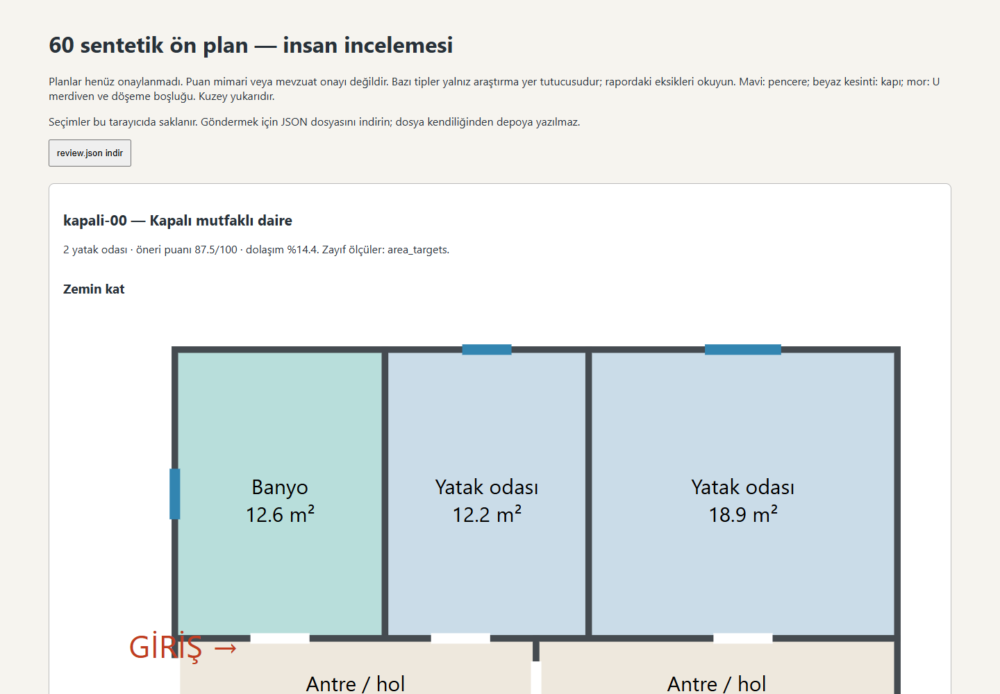
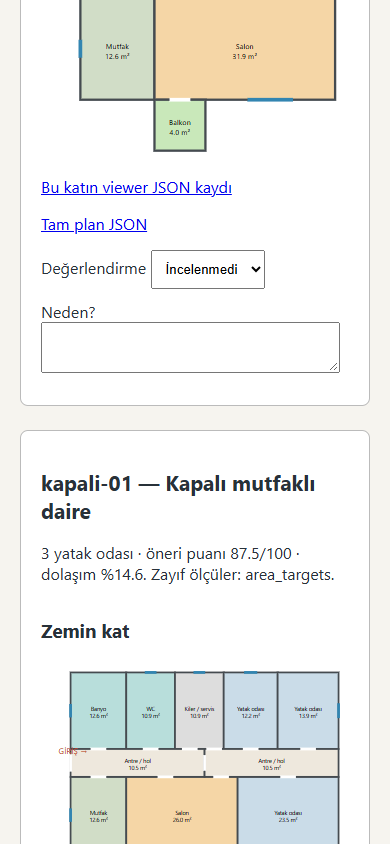

# EV-QWEN-00B inceleme paketi

[okuma.html](okuma.html) dosyasını açın. 60 taslak ve 72 kat görünümü kendi
içindedir. Tam planlar `plans/`, mevcut viewer için tek kat JSON'ları `viewer/`
altındadır. `inceleme-masaustu.png` ve `inceleme-telefon.png` arayüz kanıtıdır.
Bu sayfa canlı siteye entegrasyon veya kullanıcı onayı sayılmaz.

`review.json` bütün planları bekliyor durumunda başlatır. Sayfada iyi/zayıf ve
neden alanlarını doldurup JSON'u indirin. İndirme kullanıcı kararıdır; dosya
depoya otomatik yazılmaz. `review-data.json` hash ile eşleştirilen orijinal
plan/program/kalite kayıtlarını içerir. `review_v2.py` ancak aynı planın açık
insan kararını kabul eder. Eğitim kapısını açmaz.





## Yeniden üretim

Python 3, `tools/ev-plan/requirements.txt` bağımlılıkları. Depo kökünden:

```powershell
$env:PYTHONPATH='tools/ev-plan'
python -m unittest discover -s tools/ev-plan -p 'test*.py' -v
python tools/ev-plan/build_v2.py --output outputs/ev-qwen-00b/yeni-tur
python tools/ev-plan/baseline_v2.py --data outputs/ev-qwen-00b/yeni-tur --output outputs/ev-qwen-00b/yeni-taban --model qwen2.5:7b-instruct --count 4 --case-seconds 30 --total-seconds 65
python tools/ev-plan/review_v2.py --records outputs/ev-qwen-00b/yeni-tur/review-data.json --reviews kullanici-review.json --output outputs/ev-qwen-00b/altin-aday.json
node tools/ev-plan/viewer-smoke.cjs outputs/ev-qwen-00b/yeni-tur/viewer
```

`origin/main` güncel olmalı. Araç, canlı stüdyo dosyalarının çekilen main ile aynı
olduğunu kontrol eder. Her tur yeni çıktı dizini ister. Araçlar, şema veya kurallar
değişince veriyi yeniden üretin. Sadece gereksinimleri okumak eğitim başlatmaz.
Playwright kontrolü yerel Chrome ve `playwright` modülü ister; model denemesi
yalnız yerel Ollama'ya bağlanır, model indirmez ve ücretli API çağırmaz.

## Biçim

`train/validation/test.jsonl`: kimlik, sentetik/onay durumu, graf sınıfı ve
`messages` içeren denetlenebilir aday kayıtları. Düz SFT için her satırdan yalnız
`messages` alınır. Sistem istemi `solver/program.py::SYSTEM`'dir; eski
`convert.mjs` v0.2 biçimindedir ve **bu veri üzerinde kullanılmaz**.

Kaynak parmak izi ve her ham JSONL hash'i `manifest.json` içindedir.
Bu teslimde düz `{"messages":[...]}` dosyalarının ayrıca doğrulanmış hash'leri
`sft-manifest.json` içindedir; toplu dosyalar yerel `outputs/` altında kaldı.
137 farklı asistan hedefi yanıt sözleşmesinden geçti. 1.626 kullanıcı bağlamı
benzersiz, bölümler arasında aynı gerçekleşmiş topoloji yoktur.

1500 üretim isteği, 120 program düzenlemesi ve 6 netleştirme/reddetme adayı
vardır. İstekler bileşimsel ve yapılandırılmıştır; doğal insan diyaloğu diye
sunulmaz. Geometrik geçerlilik mimari kaliteyi ispatlamaz. 60 planın tamamı
insan incelemesi bekler; altın set boş, **eğitim ve kiralık GPU kapısı kapalı**.

Kısıtlar ve kapanmayan iş emri maddeleri için
[EV-QWEN-00B-RAPOR.md](../../EV-QWEN-00B-RAPOR.md) dosyasını okuyun.
