# ATMOSFER-01 · genel kareler

Altı aileden ikişer sabit tasarım; gerçek tarayıcıda alınmış 12 adet
2400 × 1600 JPEG ve aynı tasarımların stüdyo görünüşleri. Ürün geometrisi,
malzemesi ve renkleri gerçek motordan gelir; görüntü üreten yapay zekâ yoktur.
Kamera 55 mm'dir. Metin yeri boş bırakılmıştır.

**Bu karşılaştırmadaki 12 genel kare raster yedekle üretilmiştir.** Yol izleme
çıktısı olarak sunulmaz. Stüdyo karşılığı da bütün malzeme haritaları
tamamlandıktan sonra alınır. GTAO, 4096 gölge haritası ve SMAA kullanılır;
fiziksel dolaylı ışık veya denoiser uygulanmış olduğu iddia edilmez.
Karar sahibi estetik kabulü beklenir. Bu sayfa PR 1'in genel karelerini kapsar;
beşli yakın plan paketi ve müşteri akışı PR 2'ye aittir.

[Gerçek çekim raporu](kareler/capture-report.json) ·
[Mimari ve tekrar üretim](README.md)

| Tasarım | Stüdyo görünümü | Son görüntü · raster |
|---|---|---|
| Oturma · seating-01 · seed 101 | 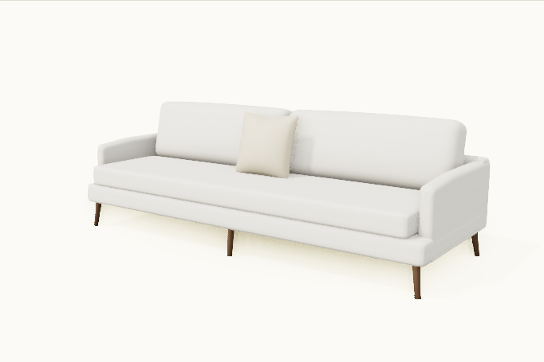 |  |
| Oturma · seating-02 · seed 202 | 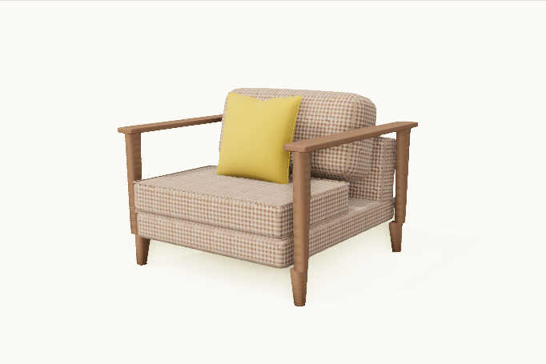 |  |
| Masa · table-01 · seed 102 | 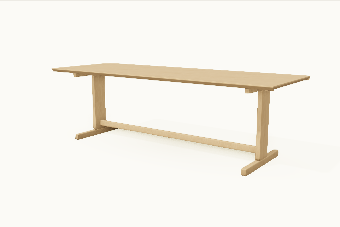 |  |
| Masa · table-02 · seed 202 | 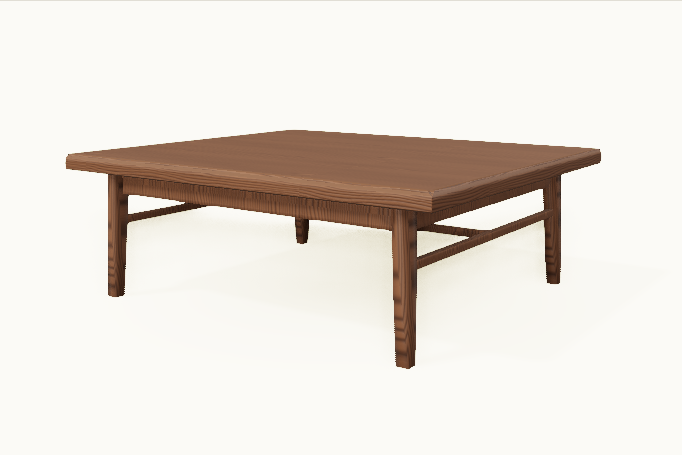 |  |
| Depolama · storage-01 · seed 103 | 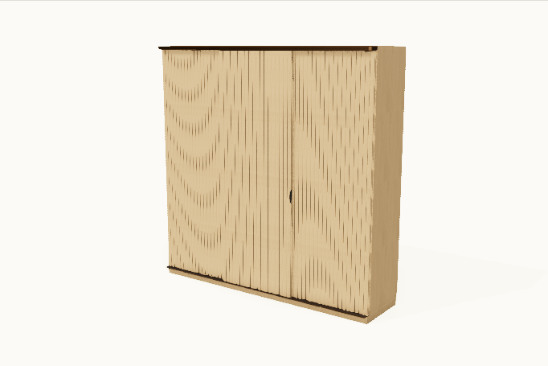 |  |
| Depolama · storage-02 · seed 202 | 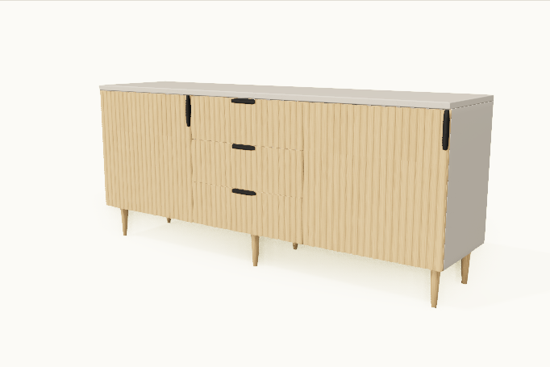 |  |
| Mutfak · kitchen-01 · seed 104 | 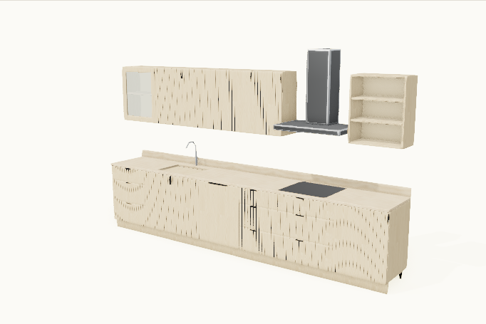 |  |
| Mutfak · kitchen-02 · seed 202 | 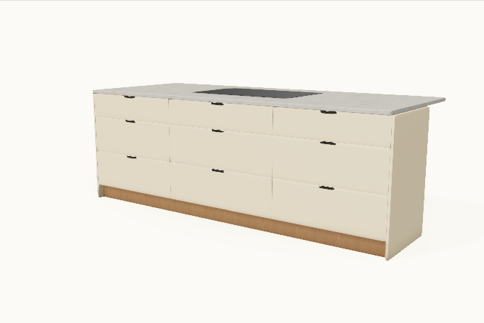 |  |
| Banyo · bath-01 · seed 105 | 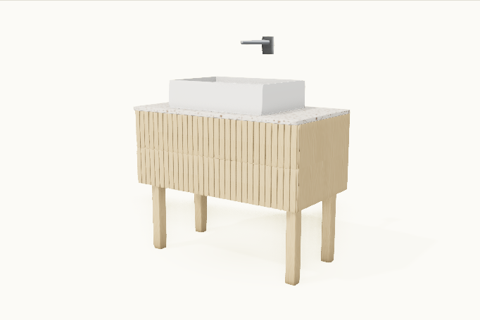 |  |
| Banyo · bath-02 · seed 202 | 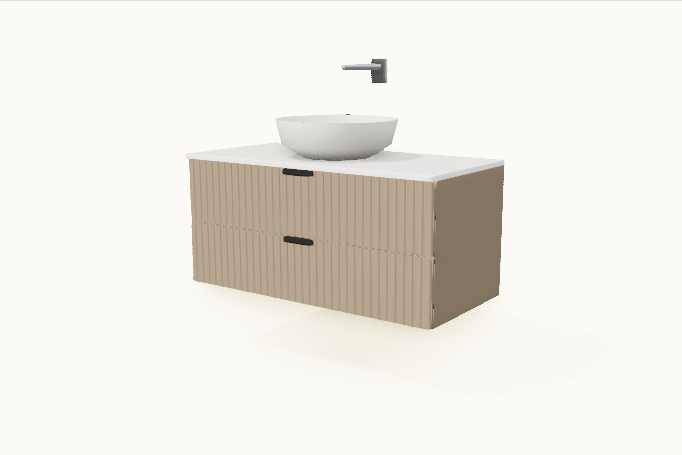 |  |
| Yatak odası · bedroom-01 · seed 106 | 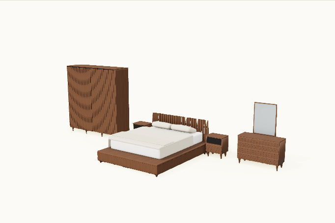 |  |
| Yatak odası · bedroom-02 · seed 202 | 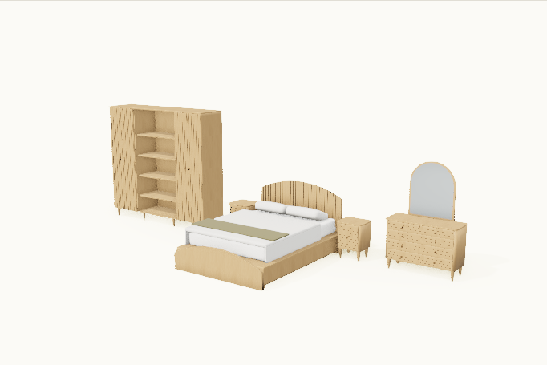 |  |

Kareler tek tek ve toplu olarak gözle denetlendi. Mutfak duvar aralığı ve yatak
odası kamera yüksekliği bu denetimde düzeltildi. Son dosyaların boyutu,
piksel varyansı ve çekimlerin boş hata listeleri ayrıca doğrulandı. Tarayıcı
ve cihaz bilgisi rapordadır; bu tek cihaz koşusu geniş cihaz kabulü değildir.
