# GÖRSEL-01 · PR 1 denetimi

Bu PR yalnızca eskizin çizgi düzenini değiştirir. Ürün geometrisi, parça listesi, malzeme,
ölçü, üretim dosyası ve renkli render yolu değişmez. Son görüntü, atmosfer, yakın plan ve
arayüz dili sonraki PR'ların konusudur.

## Çizgi kararları

- Dış siluet: ekran ölçeğinde 1,35 CSS piksel, koyu grafit. Kamera uzaklığı veya milimetre
  cinsinden model boyutu çizginin ağırlığını değiştirmez.
- Parça kenarı: 1 piksel, daha açık grafit ve %62 örtücülük; 36° eşik, küçük yüzey kırıklarının
  çizgi kalabalığını azaltır. Bu, üretim geometrisinin sadeleştirilmesi değildir.
- Kulp, fitil, düğme, hasır ve benzeri iç ayrıntı: 1 piksel, daha açık ton ve %56 örtücülük.
  WebGL'nin taşınabilir çizgi genişliği 1 piksel olduğu için bu basamak tonal ağırlıkla ayrılır.
  Dikiş/kakma çizgileri kırmızı kalır, örtücülüğü %58'e iner.
- Komşu parçaların dünya koordinatındaki aynı veya kısmen örtüşen eşdoğrusal kenarları tek
  aralığa birleştirilir. Gerçek kapak aralıkları, ayrı çizgiler ve yön değiştiren köşeler korunur.
  Derinlik testi arkada kalan çizgileri örter; görünmeyen çizgiler öne zorlanmaz.
- Yalnızca üç genel ölçü korunur; uç işaretleri kısalır, çizgi ve etiket sakinleşir.
  100 mm / 1 m perspektif ızgarası kaldırılır. Kâğıt sabit, dokusuz bir renktir.

## Sabit önce/sonra karşılaştırması

`designs.json` altı aileyi içerir: seating, table, storage, kitchen, bath, bedroom.
Her iki sürüm aynı JSON'u, aynı gerçek motoru, aynı pencere boyutunu ve aynı kamera
başlangıcını (`angle`, yaw 0.62, pitch 0.2) kullanır. Kamera veya tasarım rastgele yenilenmez.
Başlıktaki parça sayısı da görünür. Başlangıç çizgileri `f99efc17273ef0b61ffd779bd24a174568e67f62`
commit'inden okunur; motor dosyaları bu PR'da değişmemiştir.

Depo kökünde:

```sh
python tests/visual/gorsel-01/serve.py
```

Tarayıcıda aşağıdaki yolları `http://127.0.0.1:8766` köküyle açın. `view=front`,
`view=side`, `view=top` da kullanılabilir. Önce/sonra aynı görünüşte tutulmalıdır.

| Aile | Önce yolu | Sonra yolu |
|---|---|---|
| Oturma | `/tests/visual/gorsel-01/capture.html?family=seating&version=before` | `/tests/visual/gorsel-01/capture.html?family=seating&version=after` |
| Masa | `/tests/visual/gorsel-01/capture.html?family=table&version=before` | `/tests/visual/gorsel-01/capture.html?family=table&version=after` |
| Depolama | `/tests/visual/gorsel-01/capture.html?family=storage&version=before` | `/tests/visual/gorsel-01/capture.html?family=storage&version=after` |
| Mutfak | `/tests/visual/gorsel-01/capture.html?family=kitchen&version=before` | `/tests/visual/gorsel-01/capture.html?family=kitchen&version=after` |
| Banyo | `/tests/visual/gorsel-01/capture.html?family=bath&version=before` | `/tests/visual/gorsel-01/capture.html?family=bath&version=after` |
| Yatak odası | `/tests/visual/gorsel-01/capture.html?family=bedroom&version=before` | `/tests/visual/gorsel-01/capture.html?family=bedroom&version=after` |

## Gerçek tarayıcı kanıtı — karar sahibi onayı bekleniyor

Kullanıcının Playwright ile açık doğrulama isteği üzerine, 2026-10-18 tarihinde aşağıdaki
**12 gerçek WebGL tarayıcı ekran görüntüsü** alındı. Headless Chrome ayrı, geçici bir
profil kullandı; yalnızca `127.0.0.1:8766` isteklerine izin verildi. Kişisel Chrome profiline
ve yerel Windows arayüzüne erişilmedi. Her görüntü 1440 × 1000, cihaz piksel oranı 1'dir.

| Aile | Önce | Sonra |
|---|---|---|
| Oturma · seed 101 · 21 parça | 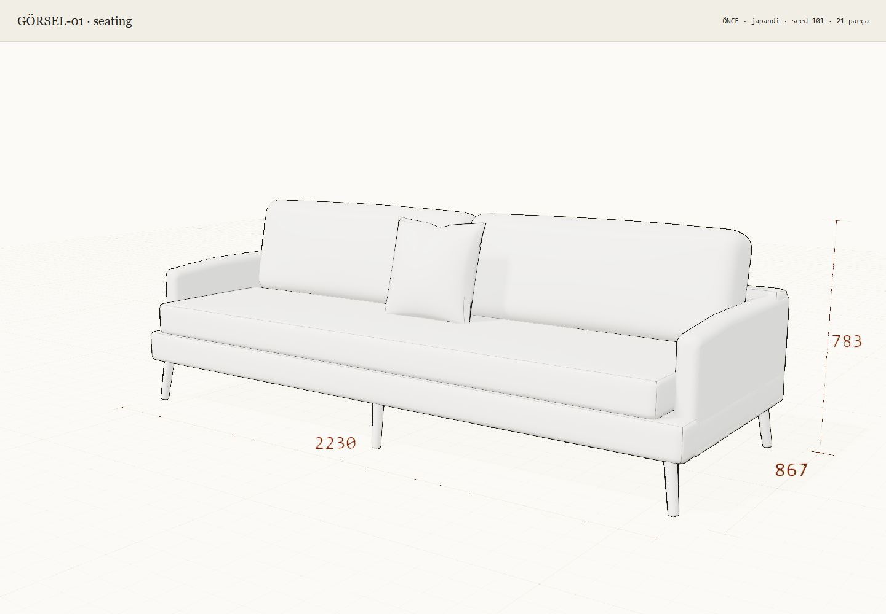 | 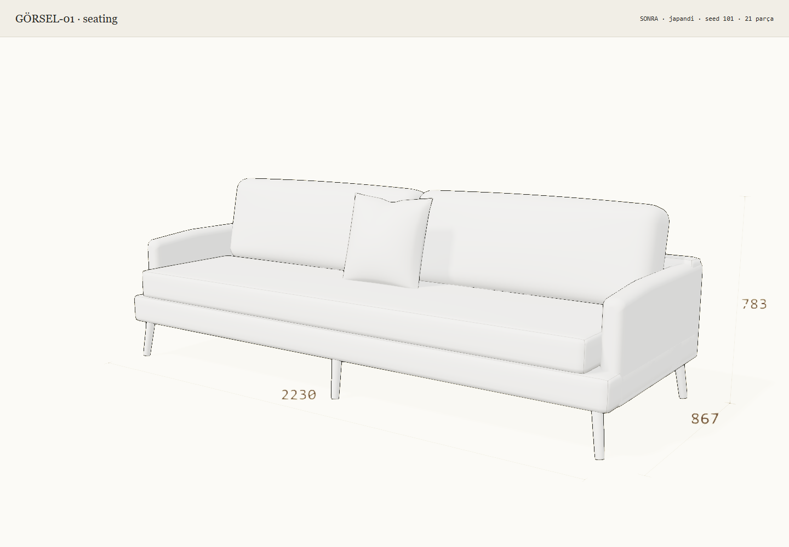 |
| Masa · seed 102 · 8 parça | 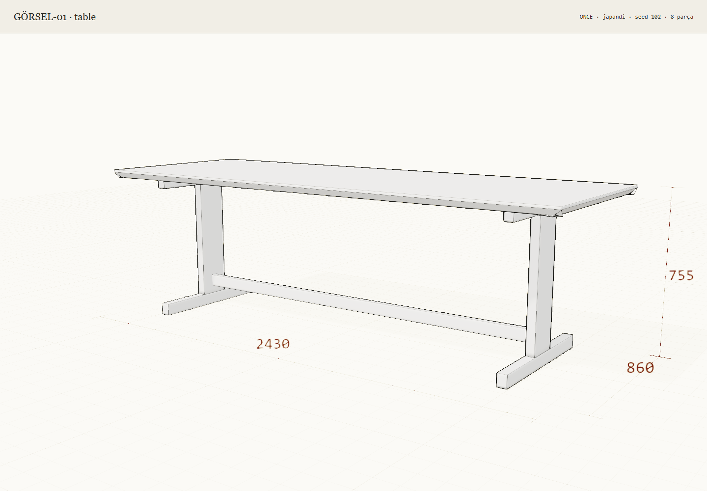 | 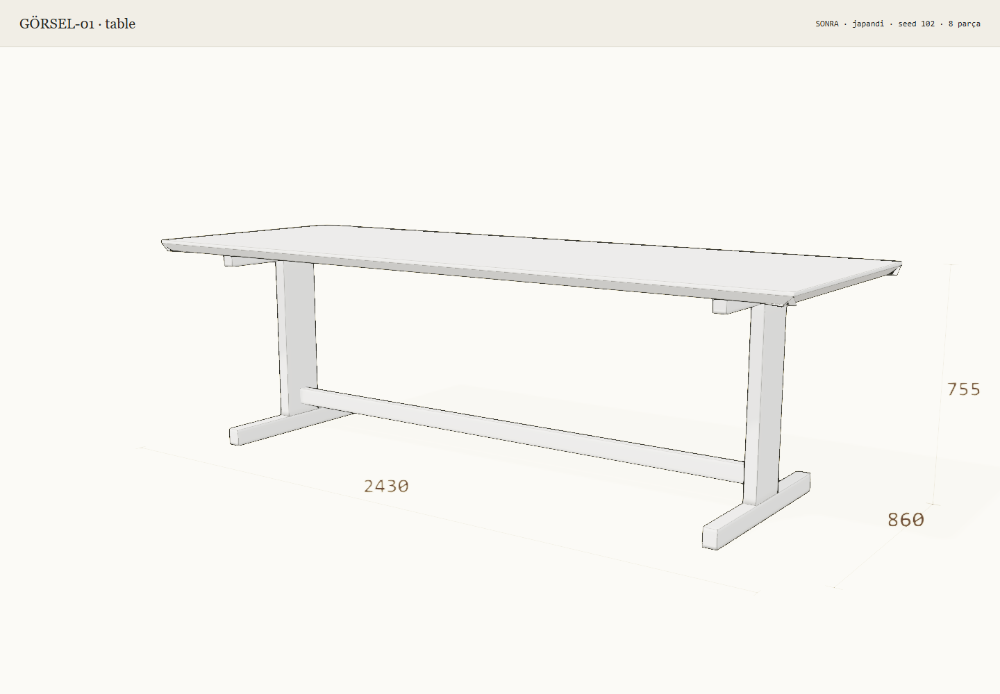 |
| Depolama · seed 103 · 117 parça | 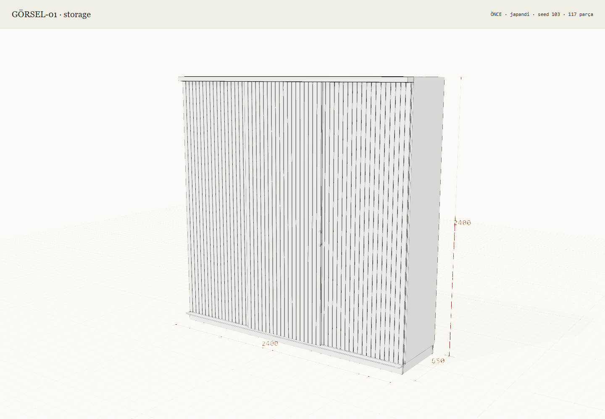 | 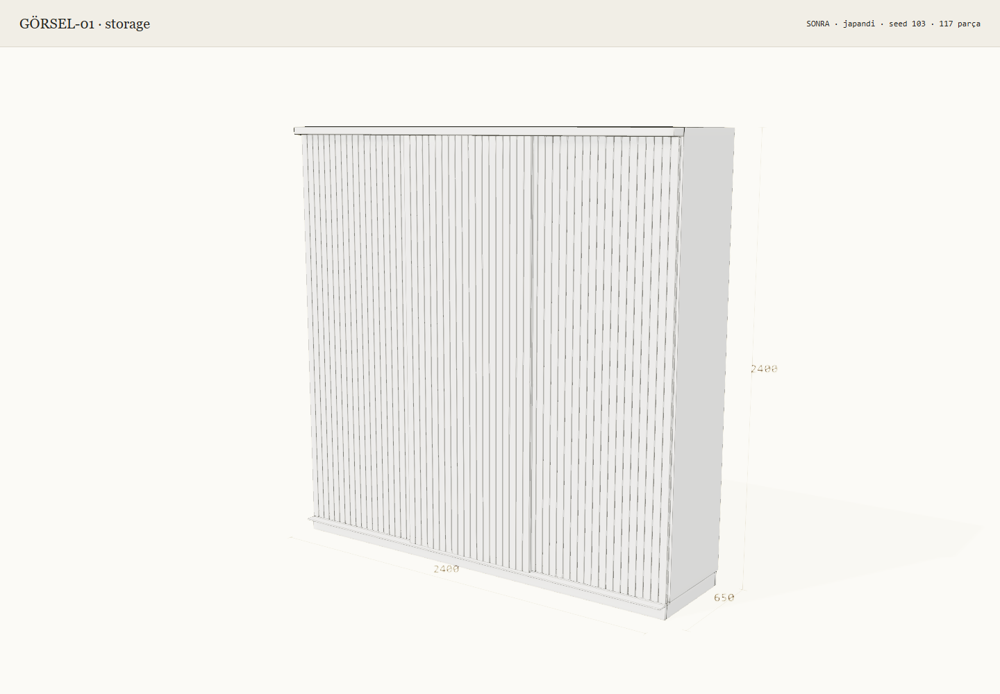 |
| Mutfak · seed 104 · 421 parça | 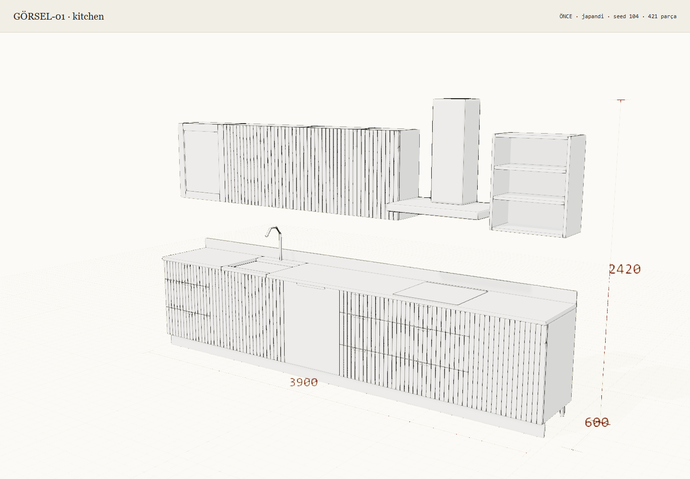 | 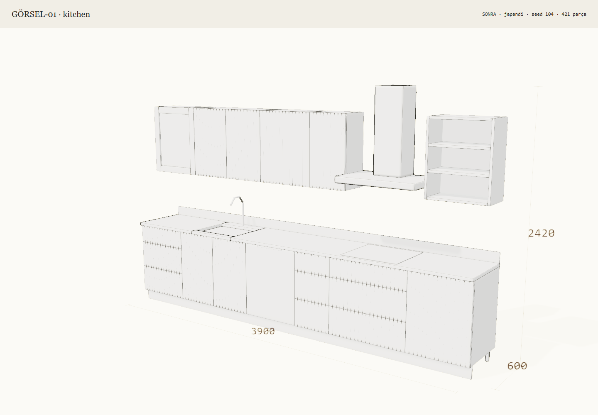 |
| Banyo · seed 105 · 94 parça | 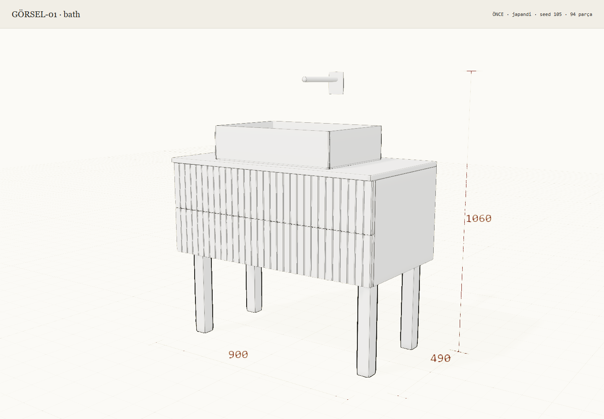 | 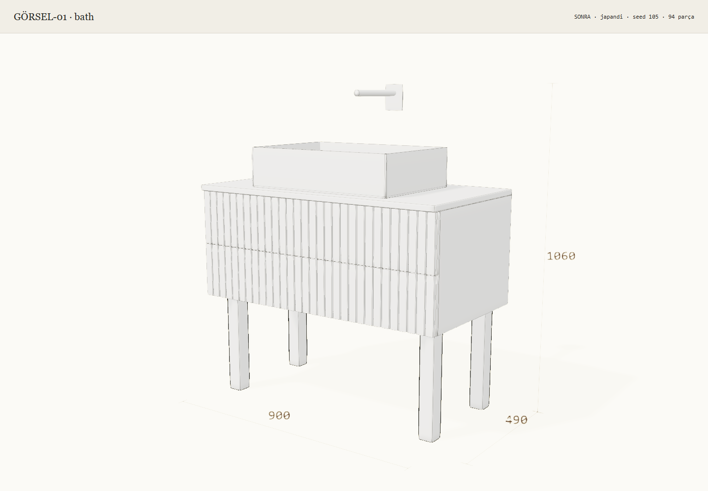 |
| Yatak odası · seed 106 · 151 parça | 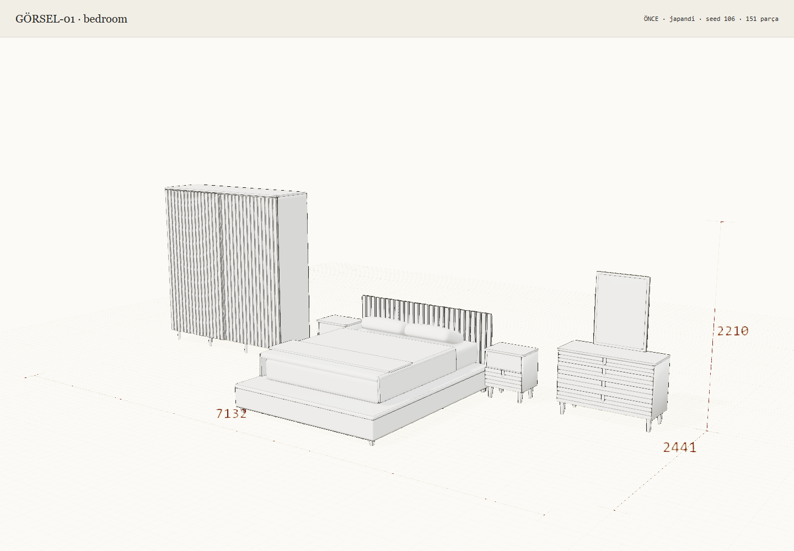 | 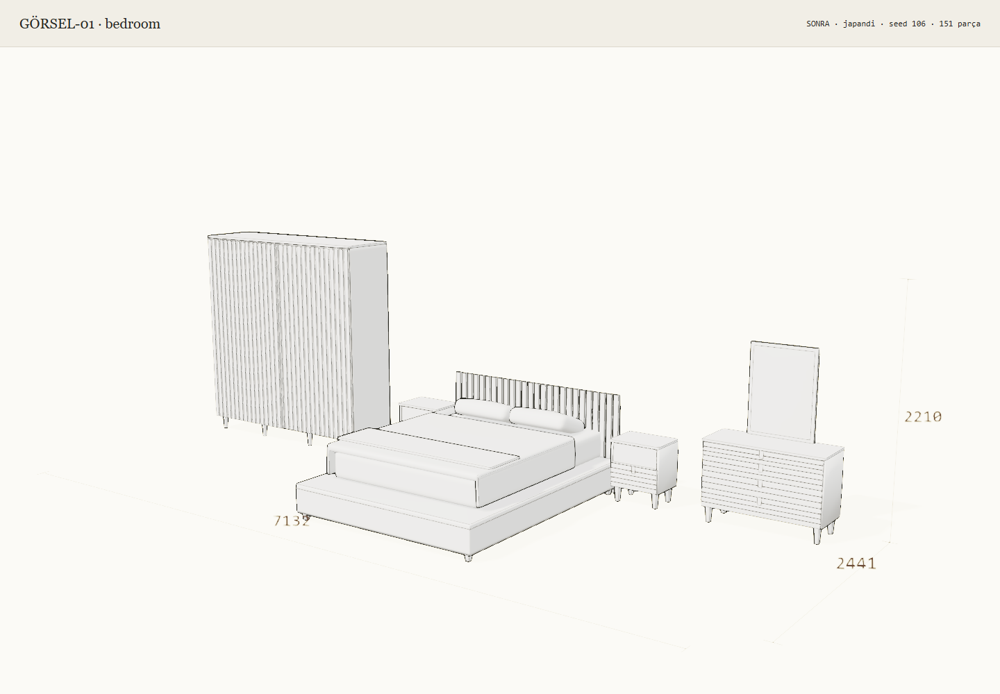 |

Görüntüler tek tek incelendi: aynı parça sayısı ve kadraj korundu, ızgara kalktı,
kapak/çekmece ayrımları ve açık raflar yerinde kaldı. İlk kontrolde fazla soluk çıkan
ölçü etiketleri ve iç ayrıntı kontrastı yükseltildi; görüntüler son kodla yeniden alındı.
Ölçülerin çizgileri ince, etiketleri okunabilir bırakıldı. Her iki sürümde de bazı eğik
kenarlarda piksel ölçeğinde kesiklilik görülebilir; bu kanıt geniş cihaz/ölçek kabulü değildir.

`capture-report.json` gerçek tarayıcı sürümünü, her çekimin URL/seed/parça/görünüş
bilgisini ve boş hata listelerini kaydeder. Hiçbir sayfa/console hatası veya shader
derleme hatası görülmedi. Çekim süreleri doku hazırlığı ve ekran kaydını da içerir;
etkileşim hızı ölçümü olarak kullanılmaz. Karar sahibinin estetik onayı henüz verilmedi;
PR birleştirilmedi.

Tekrar almak için yerel `playwright` kurulumuyla, sunucu çalışırken:

```sh
node tests/visual/gorsel-01/capture.mjs
```

Paket başka konumdaysa `PLAYWRIGHT_MODULE` ortam değişkeni kurulu paket dizinine
ayarlanabilir. Script kurulu Chrome'u headless çalıştırır, kişisel profil yüklemez.
Dokular tamamlandıktan ve iki çizim karesi geçtikten sonra PNG kaydeder.

## Otomatik kontroller

`node tests/sketch-check.mjs` eşdoğrusallık, ters yönlü kopyalar, kısmi örtüşme, gerçek
boşlukların korunması ve altı ailede sonlu/değiştirilmemiş motor geometrisini kontrol eder.
Bu geometri kontrolü görsel kalite onayı değildir; gerçek shader yolu ayrıca yukarıdaki
12 tarayıcı çekiminde çalıştırıldı.

Son taramada **18 mevcut kontrol ve yeni `sketch-check.mjs` geçti (19 başarılı)**: ai-workspace, brief-pdf,
camera-framing, catalogue, catalogue-graph, choice-flow, kitchen-studies, model, panel-engine,
preference-evidence, reference-studies, ritmo, room-family, sectional, space, studio-tools,
upholstery-engine ve forma.

`forma-check.mjs` çıkış kodu 0: 37 banyo, 99 kesim paftası, 30 mutfak, 222 depolama
tasarımı (13.385 parça), 18 oda düzeni, 270 başlangıç modeli, 339 çizgi ayrıntısı,
80 yatak odası seti, 200 masa ve 360 oturma örneği; dokuma, 8 dil komutu, çizim, DXF,
BOM, ZIP ve PDF kontrolleri geçti. Bu otomatik geometri kontrolleri shader'ı çalıştırmaz;
shader doğrulaması için tarayıcı kanıtı ayrıdır.

Ekran görüntüsü turundan sonra yalnızca ölçü/ayrıntı kontrastı değiştiği için ilgili
`sketch-check`, `camera-framing-check`, `studio-tools-check` ve JavaScript sözdizimi
kontrolleri tekrar çalıştırıldı ve geçti. 12 PNG'nin 1440 × 1000 boyutu, altı çiftin aynı
seed/style/parça/görünüş bilgisi ve boş hata listeleri ayrıca doğrulandı. Kapsamlı Forma
koşusunun yukarıdaki sonucu önceki aynı geometri koduna aittir; gereksiz yere tekrarlanmadı.

Üç arşiv kontrolü başlangıç dalında da bulunmayan `../../services/design/` modüllerini
istediğinden `ERR_MODULE_NOT_FOUND` ile durur; bu PR onları veya eksik servisleri değiştirmez.
Test dosyalarının mevcut ve `f99efc1` blob SHA'ları aynıdır:

| Test | Eksik modül | Her iki sürümde test blob SHA |
|---|---|---|
| assistant-contract-check | style-training.mjs | `5d76a589bf662877e31958ddb20df30866256844` |
| codesign-check | server.mjs | `3762b7c2392db38ed049c1f33c319536dc4a42bc` |
| studio-agent-check | studio-agent.mjs | `043a10a111d0c14c7e10ceeddea185f53db2e36d` |

Başlangıç commit'inde bu üç servis için `git ls-tree` boş döner; importların çözüldüğü
depo dışındaki `../services/design/` yolları da yoktur. Dolayısıyla tüm testler geçti
iddiasında bulunulmaz.


## 18 Ekim akşam: güncel main karşılaştırması

[Main ve #58 için ayrı gerçek test koşuları, bütün sonuçlar ve yeni başarısızlık denetimi](TEST-KARSILASTIRMA.md). Yeni başarısızlık **0**; karar sahibi görsel onayı beklenir.
